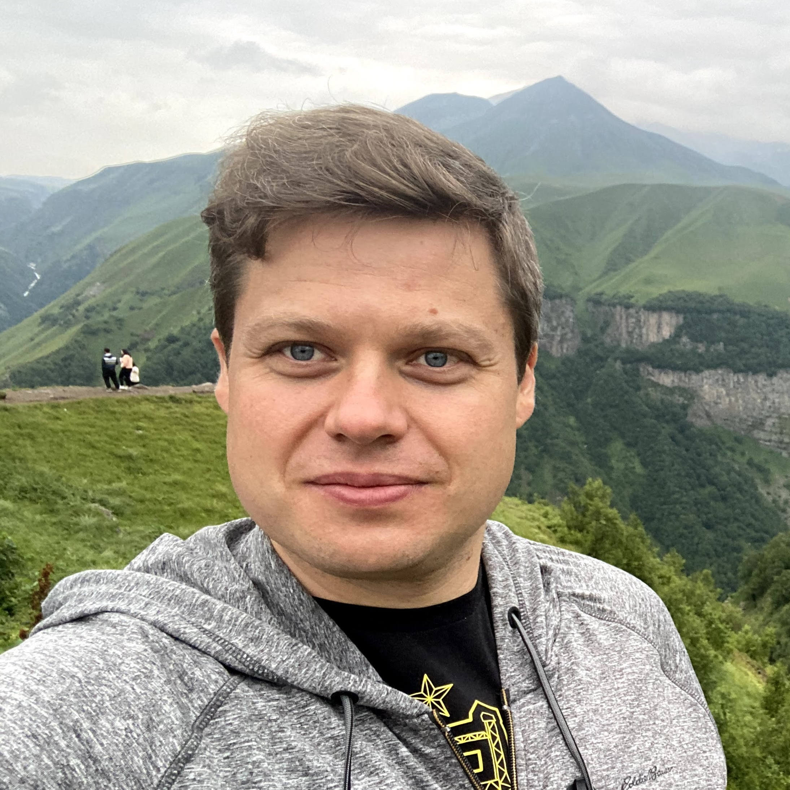

:::{layout-ncol="2"}
{width=150}

Nguyen Engineering Building MS 4A6\
Office: 2242\
Fairfax, VA, 22030\
Phone: 703 993 4533\
vsokolov@gmu.edu
:::

## Books

::: {.home-books}

::: {.home-book}
[{fig-alt="Cover of Bayes, AI and Deep Learning"}](books/bayes_ai_deep_learning/index.qmd)

[*Bayes, AI and Deep Learning*](books/bayes_ai_deep_learning/index.qmd), by Nick Polson and Vadim Sokolov, develops Bayesian reasoning, statistical learning and deep learning as one probabilistic framework, from Bayes' rule and decision theory to neural networks, transformers and AI agents, with code in R and Python.
:::

::: {.home-book}
[{fig-alt="Cover of Clinical Trials in Practice"}](books/clinical_trials_in_practice/index.qmd)

[*Clinical Trials in Practice*](books/clinical_trials_in_practice/index.qmd), by Alexandra Sokolova and Vadim Sokolov, treats a trial as science and as regulated operations: design and statistics, the daily work of a Phase III study from site selection to the trial master file, and what AI agents may and may not do in regulated research.
:::

:::

## Current Teaching
- AII 600: Foundations and Practice of Machine Learning for Artificial Intelligence ([page](courses/600.qmd))

## Areas of Expertise
- Data science: Bayesian statistics, deep learning, reinforcement learning
- Complex Systems: Agent-based models, Bayesian optimization
- Applications: Urban systems modeling, digital twins

## Bio
Vadim Sokolov is an associate professor in the Systems Engineering and Operations Research Department at George Mason University. He works on building robust solutions for large scale complex system analysis, at the interface of simulation-based modeling and statistics. This involves, developing new methodologies that rely on deep learning, Bayesian analysis of time series data, design of computational experiments and development of open-source software that implements those methodologies. Inspired by an interest in urban systems he co-developed mobility simulator called Polaris that is currently used for large scale transportation networks analysis by both local and federal governments. Prior to joining GMU he was a principal computational scientist at Argonne National Laboratory, a fellow at the Computation Institute at the University of Chicago and lecturer at the Master of Science in Analytics program at the University of Chicago.

He has published in such leading statistics, mathematics and engineering journals, as the Annals of Applied Statistics, Transportation Research Part C, Linear Algebra and Its Applications as well as in Mechanical Systems and Signal Processing. He holds a PhD in computational mathematics from Northern Illinois University, and pursued graduate studies in statistics at the University of Chicago, while working at Argonne.

